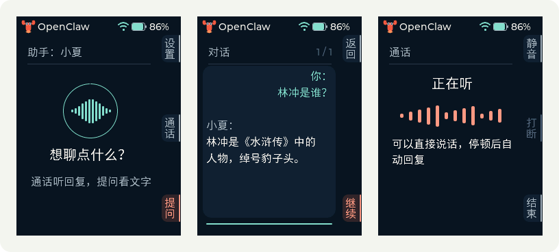
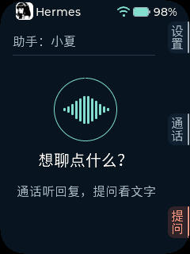
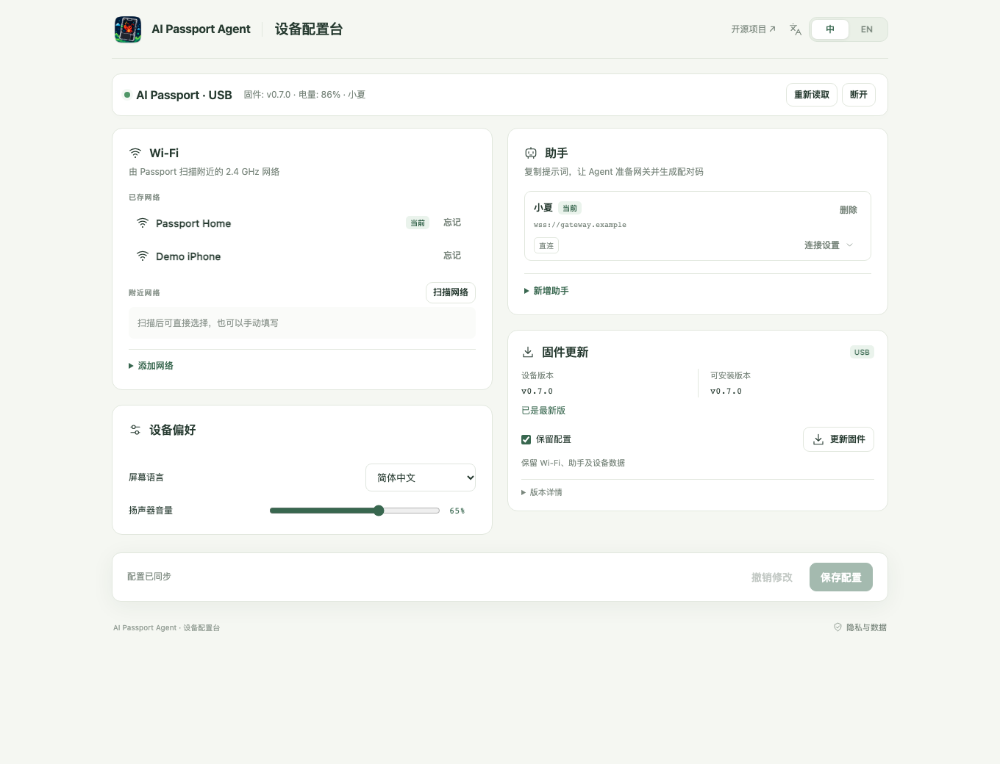

<p align="right"><a href="README.zh_CN.md">简体中文</a> · <strong>English</strong></p>

<p align="center"></p>
<h1 align="center">AI Passport Agent</h1>
<p align="center"><strong>A wearable voice terminal for your personal agent</strong><br />Voice Q&amp;A and realtime calls with OpenClaw or Hermes</p>
<p align="center">
  <a href="https://ai-passport-agent.codelife.me/">Open web studio</a> ·
  <a href="#get-started">Get started</a> ·
  <a href="https://github.com/vangie/ai-passport-agent/releases/latest">Latest release</a> ·
  <a href="README.zh_CN.md">Simplified Chinese</a>
</p>



Turn FoloToy AI Passport into a dedicated voice interface for your personal agent.
Ask a question, read the answer, or have a spoken conversation. The device connects
over Wi-Fi; a phone is not an audio relay.

**v0.7.0: OpenClaw and Hermes.** Use the matching external plugin for your backend.
Other agent integrations are not available yet.
The project was previously named `ai-passport-openclaw`; existing devices and
OpenClaw plugin installations remain compatible. The web studio is now at
<https://ai-passport-agent.codelife.me/>; the former
`ai-passport-openclaw.codelife.me` address redirects there. See
[naming and compatibility](docs/configuration.md#project-name-and-compatibility).

An independent community project based on [FoloToy/ai-passport](https://github.com/FoloToy/ai-passport),
not official FoloToy firmware or an OpenClaw distribution. Installing it replaces
the stock application and does not retain all of its original features.

## Two ways to talk

| | Ask | Call |
| --- | --- | --- |
| Best for | Questions, tasks and answers to read | Back-and-forth spoken conversation |
| Start | Press to record; press again to send, or pause after speaking | Connect, wait for Listening, then speak |
| Feedback | Waveform, your transcript and streamed reply text | Waveform, spoken replies and scrolling subtitles |
| Continue or leave | Follow up, page through messages or return | Use the displayed keys to mute, interrupt or end |

The home screen has **Settings / Call / Ask**. Captions beside the physical keys
change with each screen. Chinese and English, volume adjustment, saved network
switching and connection indicators are built in. Ask reaches your agent's tools
and context, not just a standalone chat model. Call needs a realtime voice provider
on the gateway. Speed, tools and voice
quality depend on that provider, your gateway and network.

## Choose your personal agent

| Backend | Ask | Call | Installation |
| --- | --- | --- | --- |
| OpenClaw | Dedicated `passport` agent with its authorized tools | Realtime voice with agent delegation | [OpenClaw plugin](tools/openclaw/README.md) |
| Hermes | Native personal agent, tools and memory; a conversation per device | Realtime voice with native-agent delegation | [External Hermes plugin](tools/hermes/README.md) |

Call's realtime model handles ordinary dialogue; tasks, current information and
private context can be delegated to the personal agent. Not every spoken turn
runs a full agent task. Both backends need your own working model configuration;
Call requires a separate realtime voice service. Provider charges are separate.

<p align="center"></p>

## Configure in your browser

**[Open the web studio →](https://ai-passport-agent.codelife.me/)** No app installation,
local Python or command-line flasher required.



| Your screen | Connection | What you can do |
| --- | --- | --- |
| Computer · Chrome or Edge | USB | Install/update firmware, configure Wi-Fi and assistants, adjust language and volume |
| Computer · a Web Bluetooth browser | Bluetooth | Read and save settings; firmware updates still need USB |
| iPhone · [Bluefy](https://apps.apple.com/app/bluefy-web-ble-browser/id1492822055) | Bluetooth | Add Wi-Fi or a personal hotspot and edit assistant settings; no USB flashing |

Bluetooth support varies by browser and OS. Safari and Chrome on iPhone do not
provide the required Bluetooth API. Bluefy was tested by the maintainer; other
browser/OS combinations still need device testing. See [browser compatibility](docs/web.md).

- **One save for your changes.** Wi-Fi, assistant and preference edits stay in a
  draft until saved. Failures do not erase your inputs; Discard restores the last
  read/acknowledged state. A multi-setting save is not atomic.
- **Settings live on Passport.** Up to eight networks and four assistant
  connections travel with it. Switching saved Wi-Fi does not require pairing again.
- **Update only when you choose.** Saving configuration never flashes firmware.
  Keep settings is checked by default; first installation/full replacement requires
  unchecking it and confirming the data overwrite.
- **No application backend.** Configuration is sent directly to the device over
  USB/Bluetooth. This site does not upload it to a project server. Draft secrets
  stay in page memory, not browser storage; close the page when finished.

## Get started

You need an AI Passport, a data-capable USB cable, reachable **2.4 GHz Wi-Fi** or
a compatible hotspot, and a running OpenClaw or Hermes with a working model. Initial flashing
needs desktop Chrome/Edge. **OpenClaw 2026.10.5** is the tested plugin baseline;
check compatibility before upgrading. Call also needs realtime voice credentials.

1. **Install firmware.** Connect Passport by USB, open the
   [web studio](https://ai-passport-agent.codelife.me/) and select its serial
   port. For a first install, uncheck **Keep settings**, choose **Install firmware**
   and confirm. Compatible updates use **Update firmware** with settings kept.
   Read the [data policy](docs/development/engineering/firmware-layout.md#flashing-and-stored-data)
   before replacing another firmware; there is no automatic stock-firmware rollback.
2. **Prepare your agent.** Under **Add assistant**, select OpenClaw or Hermes,
   choose **Copy Prompt** and send
   it to an agent able to operate on your gateway host. It checks/installs the
   matching plugin, prepares the backend's assistant and a secure reachable ingress,
   then returns an address and limited pairing code. Existing resources are reused;
   missing accounts, permissions or credentials still require your action.
3. **Set Wi-Fi and pair.** Scan nearby networks or type a name and password.
   Import the gateway address and pairing code, then **Save configuration**.
   Wait for the Wi-Fi icon; use the device connection check before a first Ask.
   Correct and retry failures without reflashing; expired codes need replacement.
4. **Talk.** Choose **Ask** or **Call** on Passport and follow the key captions.
   Close the setup page afterward. To change networks, use **Settings → Wi-Fi**;
   use the web page to add a network or correct its password.

For an iPhone hotspot, turn on **Allow Others to Join** and **Maximize Compatibility**.
Keep the Personal Hotspot settings page open if it does not appear during scanning.
A new network must be reachable for the initial save. Later, keep the hotspot on
and select it from Passport's saved networks. A computer can prepare this over USB;
Bluefy can configure it over Bluetooth without switching the phone's Wi-Fi.

See [configuration and everyday use](docs/configuration.md) for the full workflow.

## Your gateway, your permissions

```text
Web studio ── USB / Bluetooth ──> Passport settings
Passport   ── Wi-Fi / WSS ─────> OpenClaw or Hermes + plugin ──> Your providers
```

The setup page is not a cloud assistant and does not carry conversations. Model
API keys stay on the gateway. Both plugins use native integration points, not core
patches. Hermes installs outside the core checkout; ordinary core upgrades preserve
the plugin and device grants. Future API compatibility still needs verification.
The upgraded Hermes v0.23.1 passed plugin discovery and adapter tests; new-version
microphone/speaker acceptance remains pending. See the backend installation guides.

For remote use, the bilingual [connectivity and security guide](docs/networking.md)
covers **Cloudflare Tunnel**, **SakuraFrp with TLS**, LAN access, proxies, pairing
and revocation. Keep the gateway bound to loopback, use public **WSS**, retain
device authentication and never distribute the administrator token. A tunnel
provides reachability, not automatic access control. LAN-only use is possible
when Passport can actually reach that LAN address.

Possession of a paired device grants its configured authority. Limit OpenClaw's
dedicated agent and review Hermes's native-agent tool policy; device-side interactive
approval is not supported. Revoke lost devices. Bluetooth uses encrypted Just Works pairing,
not proof of ownership or protection against an active man-in-the-middle; configure
in a trusted environment and disable it when unnecessary in an untrusted place.
Recording/calls temporarily release Bluetooth memory, then restore it afterward.

## Tap for a hotspot

Use the Passport's passive NFC tag to trigger **iPhone Shortcuts → Automation → NFC**:

1. Save and test the hotspot on Passport using the web studio first.
2. Scan its tag in the NFC automation and choose **Run Immediately**, if available.
3. Add **Set Personal Hotspot → On**. Prefer On over Toggle, so another tap does
   not accidentally turn the hotspot off.

If tapping still opens the original website, back up the tag with an NFC writer
and **replace its URL record with a plain-text record**, such as `AI Passport`.
Do not just append a text record. This removed the website banner in the maintainer's
iPhone test. Do not change the UID, lock bits or configuration area. Flashing
firmware does not rewrite the NFC tag. Never store passwords or pairing credentials
on it. iOS automation behavior varies; this is not device authentication.
See [NFC details](docs/configuration.md#nfc-and-personal-hotspot).

## Releases and development

Releases contain application/merged firmware, a firmware bundle, an installable
OpenClaw plugin, `release-manifest.json`, `SHA256SUMS.txt` and license information.
v0.7.0 also packages `ai-passport-hermes-0.7.0.tar.gz`. No native apps are packaged.
The web studio serves verified firmware on its own origin: your browser does not
follow GitHub Release download redirects. GitHub Pages itself may still be
unreachable on some networks. Hashes detect corruption, not a compromised publisher.

| Component | Source / guide |
| --- | --- |
| Web studio | `web/` · [Browser guide](docs/web.md) |
| Firmware | `app/`, `main/`, `components/bsp/` · [Build and test](docs/development/engineering/build-and-test.md) |
| OpenClaw plugin | [`tools/openclaw/`](tools/openclaw/README.md) |
| Hermes plugin | [`tools/hermes/`](tools/hermes/README.md) |
| Network ingress | [Connectivity and security](docs/networking.md) |
| Release process | [CI and releases](docs/development/ci/CI-build-and-release.md) |

```sh
make web             # Reentrant local preview; optional cloudflared HTTPS tunnel
make preview-ui      # Render actual firmware UI with fictional data
make plugin-test
make plugin-package
./tools/validate.sh   # Full gate; activate ESP-IDF 5.5.3 first
```

CI checks sources/secrets, host tests, firmware, browser UI and plugin packages.
Native client source is retained in `mac/`, `ios/` and `shared/` for developers;
it is not part of the recommended setup, build pipeline or release downloads.
Automated UI/firmware checks do not replace physical audio, radio or battery testing.
Screenshots use fictional networks, assistant names and reserved example endpoints.

## License and credits

[MIT](LICENSE), retaining FoloToy attribution. Fonts and third-party assets retain
their notices; see [asset sources](assets/README.md). Please report sensitive issues
privately using the [security policy](.github/SECURITY.md).
