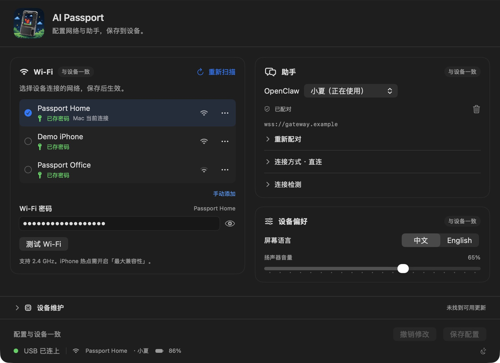
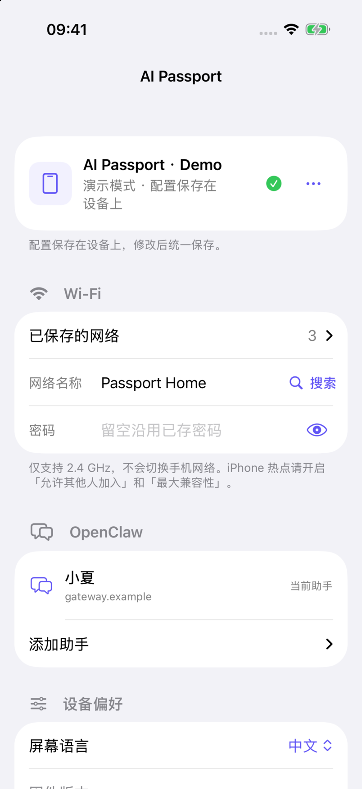

<p align="right"><a href="README.zh_CN.md">简体中文</a> · <strong>English</strong></p>

<p align="center"></p>

<h1 align="center">AI Passport OpenClaw</h1>

<p align="center"><strong>Your OpenClaw assistant. A button away.</strong></p>
<p align="center">A wearable voice terminal for FoloToy AI Passport.<br />Ask a question, start a voice call, and leave the phone in your pocket.</p>

<p align="center">
  <a href="https://github.com/vangie/ai-passport-openclaw/releases">Download</a> ·
  <a href="#get-started">Get started</a> ·
  <a href="#tap-for-a-hotspot">NFC hotspot tip</a> ·
  <a href="docs/configuration.md">Configuration guide</a>
</p>


An independent community project built on [FoloToy/ai-passport](https://github.com/FoloToy/ai-passport).
Not official FoloToy firmware or an OpenClaw distribution. This firmware replaces
the stock application; it does not promise to retain its original features.

## Two ways to talk

| | Ask | Call |
| --- | --- | --- |
| Best for | A question, a task, an answer to read | A back-and-forth voice conversation |
| Interaction | Press to record; press again to send, or pause after speaking | Speak naturally once connected; pause for a reply |
| Feedback | Recording waveform, your transcript and streamed reply text | Microphone waveform, spoken replies and scrolling subtitles |
| Keep going | Continue adds a turn; page through recent messages | Mute, interrupt or end using the on-screen key labels |

The home screen has just **Settings / Call / Ask**. Button captions sit beside
the physical keys and change with the current screen. Chinese and English UI,
battery and connectivity indicators, and adjustable speaker volume are included.

Ask uses a dedicated OpenClaw `passport` agent. Call uses a realtime voice
provider configured on the gateway. Model availability, tools and response speed
depend on your gateway, provider and network, not only the device.

## Configure on the screen you have

### Mac: set up, maintain, and get back to talking



- **One page, one save.** Edit Wi-Fi, assistant profiles, language and volume,
  then save together. Discard restores the last device state; failed saves do
  not wipe your inputs.
- **USB you can see.** Connection, device Wi-Fi, assistant and battery readings
  appear in the footer. Check the gateway from the device's actual network.
- **Firmware when needed.** Device Maintenance updates compatible application
  firmware over USB. Saving settings is separate and never reflashes it.
- **Less retyping.** Remember Wi-Fi passwords locally, reuse them, or forget
  individual entries. See the [local storage notes](docs/configuration.md#where-settings-live).

### iPhone: Wi-Fi setup without leaving your network

<p align="center"></p>

- Connect over **Bluetooth**, without switching the phone to a setup hotspot.
- Ask the **Passport to scan** nearby 2.4 GHz networks; results appear as they
  arrive on compatible firmware. Recognized iPhone hotspots get a link icon.
- Reuse saved networks, add a hotspot, scan pairing information and save changes
  to the device. The phone does not need to stay connected afterward.

All screenshots above show the actual firmware renderer or native apps with
**demonstration data**: fictional networks, assistant names and `.example`
endpoints. They are UI previews, not photos or proof of hardware connectivity.

## Yours, not a phone relay

```text
Mac app ── USB ─────┐
                   ├── configure ── AI Passport
iPhone app ── BLE ──┘                    │
                                       Wi-Fi / personal hotspot
                                        │
                              Your OpenClaw gateway
                              + AI Passport plugin
                                        │
                                  Models and tools
```

The Passport sends conversations **directly to your gateway**. Mac and iPhone
apps configure it; they do not relay audio. Use your own LAN or an existing
authenticated public WSS endpoint. There is no shared hosted gateway bundled
with this project.

Up to **8 Wi-Fi networks** and **4 assistant connection profiles** live on the
device. Switch saved networks and assistants from Settings without reflashing.
Profiles choose gateway connections; Ask currently keeps the `passport` agent ID.

## Get started

You need a FoloToy AI Passport, a data-capable USB cable, a 2.4 GHz Wi-Fi network
or compatible phone hotspot, and your own OpenClaw gateway.

1. **Prepare OpenClaw.** Install the [AI Passport plugin](tools/openclaw/README.md),
   create the dedicated `passport` agent and choose its model/tool permissions.
   Configure a realtime-capable provider for Call. **OpenClaw 2026.10.5** is the
   tested baseline; model API keys stay on the gateway. The plugin uses native
   integration without patching installed OpenClaw core files.
2. **Make it reachable.** Use an existing LAN or public WSS address. For
   Cloudflare Tunnel, SakuraFrp, TLS and authentication, follow
   [Gateway connectivity](docs/networking.md). A tunnel alone is not access control.
3. **Install matching firmware.** Download a [Release](https://github.com/vangie/ai-passport-openclaw/releases)
   and connect by USB. A blank device needs the merged image at `0x0`; compatible
   application-only updates use `0x10000`. Read the
   [flashing and data policy](docs/development/engineering/firmware-layout.md#flashing-and-stored-data)
   first: a full merged flash can reset stored settings.
4. **Connect and pair.** In the Mac app or locally installed iPhone app, choose
   Wi-Fi and enter its password. Use **Copy Prompt** to ask your OpenClaw agent
   for an existing reachable address and limited setup code; import the result
   or scan its QR code. You do not need the administrator's gateway token.
5. **Save and talk.** Save configuration, then choose Ask or Call on the Passport.
   For later changes, read settings from the device, edit and save again.

### What's in a Release?

| Artifact | Use |
| --- | --- |
| `ai-passport-openclaw-macos-universal-adhoc.zip` | macOS 14+, Apple Silicon and Intel; includes matching firmware |
| `ai-passport-openclaw-firmware.tar.gz` | Application/merged images, manifest, bootloader, partition table and flash parameters |
| `ai-passport-openclaw-<plugin-version>.tgz` | Installable gateway plugin |
| `ai-passport-openclaw-ios-source.zip` | iPhone source kit with shared code and signing instructions; build with your own Xcode team |
| `ai-passport-openclaw-ios-simulator.zip` | Mac Simulator preview only, not installable on an iPhone; no real BLE |

Check the release's `SHA256SUMS.txt`. The Mac app is currently **ad-hoc signed,
not Developer ID signed or notarized**; macOS may require local security approval.
USB flashing requires Python 3 and `esptool` (for example,
`pipx install esptool==4.11.0`). The app does not silently install system tools.
There is **no signed iPhone download**, App Store or TestFlight release.
Use the source kit and [installation instructions](docs/release/ios-install.md)
to build/sign on your own iPhone, or the Simulator ZIP for a Mac-only preview.

## Tap for a hotspot

The Passport's passive NFC tag can trigger an **iPhone Shortcuts automation**:

1. Configure your iPhone hotspot on the Passport once over Bluetooth. Enable
   **Allow Others to Join** and **Maximize Compatibility** in iOS Settings.
2. In **Shortcuts → Automation → NFC**, scan the Passport and select
   **Run Immediately**, if available.
3. Add **Set Personal Hotspot → On**. Optionally add **Open App → AI Passport**.
   Prefer On over Toggle so a second tap does not turn the hotspot off.

**Still getting the original website banner?** The stock NFC tag may contain a
URL record. Back up its contents with an NFC writer, then **replace that URL
with a plain Text record**, such as `AI Passport`; do not merely append text.
This removed the website prompt and worked with the hotspot automation on the
maintainer's iPhone. Do not overwrite the tag UID, lock bits or configuration.
The NFC tag is independent of firmware; USB flashing does not rewrite it.

This is an optional iOS automation, not device authentication or a guarantee of
silent execution on every iOS version. It opens the app only if requested;
it does not automatically pair Bluetooth or write settings. Never put passwords
or pairing credentials on the tag. See [NFC details and troubleshooting](docs/configuration.md#nfc-and-personal-hotspot).

## Privacy and sensible limits

- **No personal endpoints or secrets in clean firmware.** Gateway URLs, Wi-Fi
  and device credentials come from your configuration. Model keys remain on
  OpenClaw. Screenshots use fictional data, not redacted private exports.
- **Pair devices, not admin tokens.** A paired Passport carries its configured
  authority. Revoke lost devices in OpenClaw and choose tool permissions accordingly.
- **Bluetooth has a boundary.** Configuration uses encrypted Just Works pairing,
  not proof of ownership or MITM protection. Turn it off in device Settings when
  configuration is not needed in an untrusted environment.
- **Hardware stays modest.** ESP32-C3, 8 MB Flash, no PSRAM, a 240 × 320 display
  and 2.4 GHz Wi-Fi. BLE is temporarily released during audio/gateway work, then
  restored. UI previews cannot validate radio coexistence or audio quality.

## Build, extend, contribute

| Component | Source / guide |
| --- | --- |
| Firmware and board support | `app/`, `main/`, `components/bsp/` · [Build and test](docs/development/engineering/build-and-test.md) |
| Mac and iPhone apps | `mac/`, `ios/`, `shared/` · [Configuration guide](docs/configuration.md) |
| Upgradeable OpenClaw plugin | [`tools/openclaw/`](tools/openclaw/README.md) |
| Networking | [LAN, tunnels, proxies and troubleshooting](docs/networking.md) |
| Project documentation | [Documentation index](docs/README.md) · [Contributing](.github/CONTRIBUTING.md) |

With the [required tools](docs/development/engineering/environment-setup.md) installed:

```sh
make preview-ui       # Render the actual LVGL screens locally
make sim-passport     # PassportSim, with its dependencies installed
make sim-mac          # Build and launch the Mac app
make sim-iphone       # Build and launch in the iPhone simulator; no real BLE
make plugin-test
make plugin-package
./tools/validate.sh   # Full gate; activate ESP-IDF 5.5.3 first
```

CI checks public sources, secrets, host tests, Mac builds, ESP-IDF firmware,
iPhone device/Simulator builds and UI tests, and the plugin on Node 22/24/26.
Version tags publish only after the required jobs
pass; manual Release runs keep artifacts without publishing a GitHub Release.
See [CI and releases](docs/development/ci/CI-build-and-release.md).

## License and credits

[MIT](LICENSE), retaining FoloToy's attribution. Hardware/BSP and development
documentation derive from the upstream project; fonts and third-party assets
retain their notices. See [asset sources](assets/README.md). Report sensitive
issues privately using the [security policy](.github/SECURITY.md).
