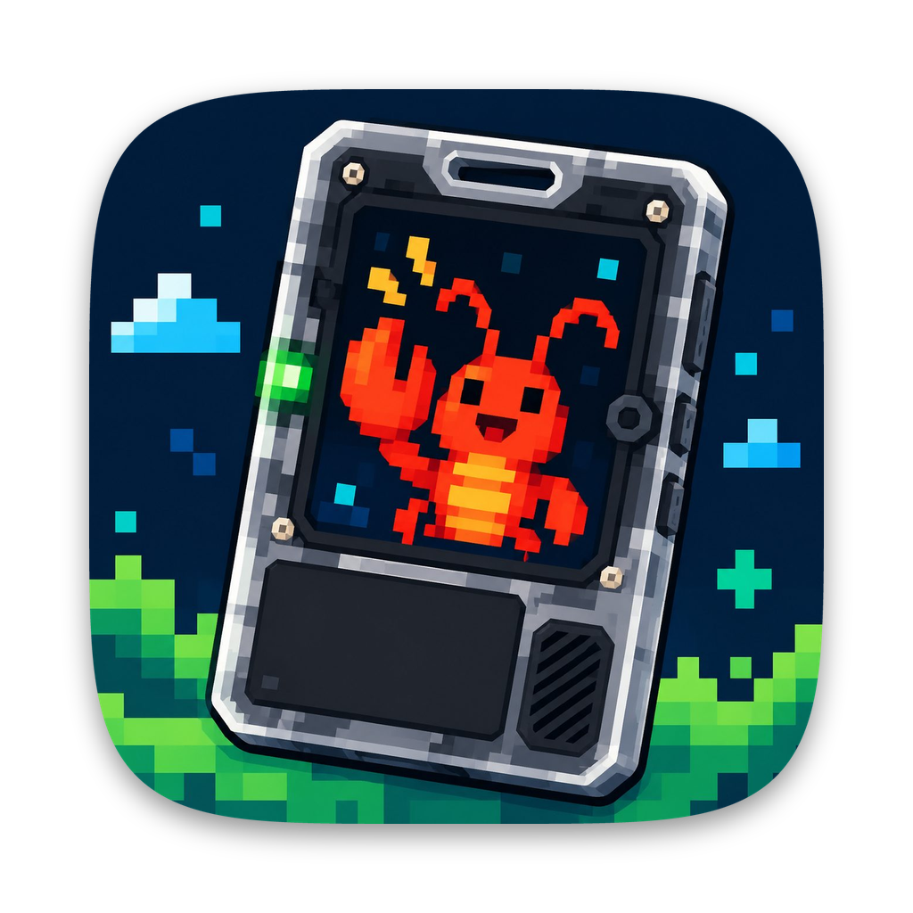
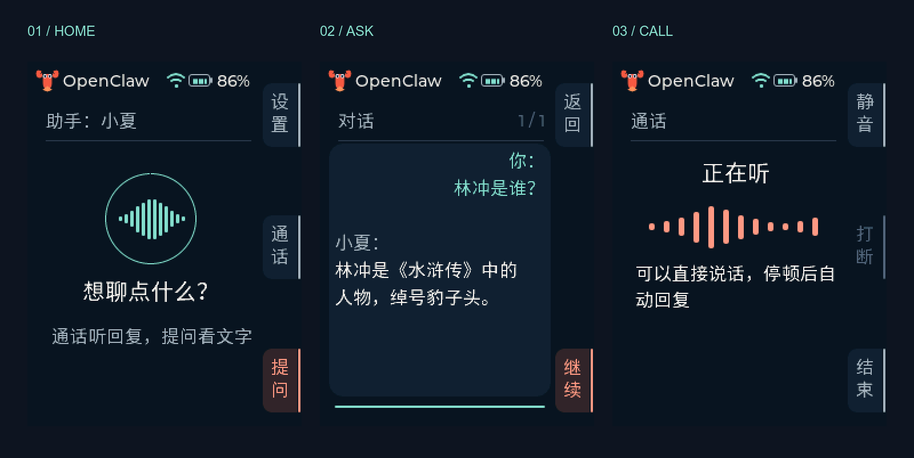
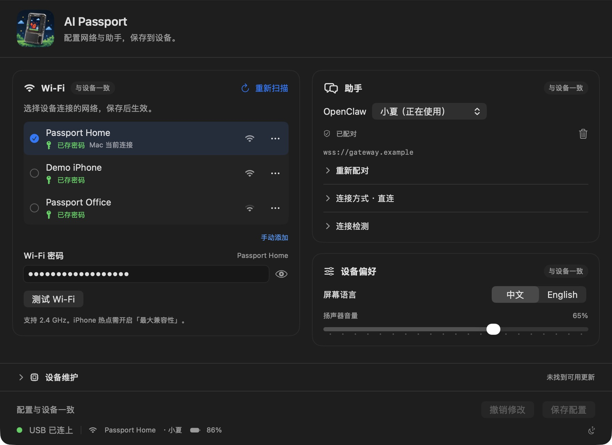
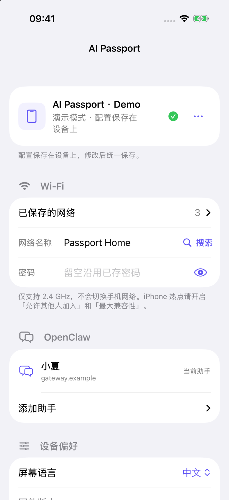

<p align="right"><a href="README.md">English</a> · <strong>简体中文</strong></p>

<p align="center"></p>

<h1 align="center">AI Passport OpenClaw</h1>

<p align="center"><strong>你的 OpenClaw，随身一键直达。</strong></p>
<p align="center">为 FoloToy AI Passport 打造的随身语音终端。<br />问个问题，聊上一会儿，手机留在口袋里。</p>

<p align="center">
  <a href="https://github.com/vangie/ai-passport-openclaw/releases">下载</a> ·
  <a href="#开始使用">开始使用</a> ·
  <a href="#碰一下开启热点">NFC 热点技巧</a> ·
  <a href="docs/configuration.zh_CN.md">配置指南</a>
</p>



这是基于 [FoloToy/ai-passport](https://github.com/FoloToy/ai-passport) 的独立社区项目，
不是 FoloToy 官方固件，也不是 OpenClaw 发行版。刷入会替换原有应用，
不承诺保留官方固件的原有功能。

## 提问，或者通话

| | 提问 | 通话 |
| --- | --- | --- |
| 适合 | 问一个问题、交代一件事、看文字答复 | 连续来回聊，不必每句都按键 |
| 操作 | 按一下开始录音；再按一下发送，说完停顿也可自动提交 | 连上后直接说，停顿后等待回复 |
| 反馈 | 录音波形、自己的转写、助手流式文字回复 | 麦克风波形、语音回复、自动滚动字幕 |
| 继续 | 接着问，保留最近几轮，长内容可翻页 | 按屏幕旁的三个键静音、打断或结束 |

首页只有 **设置／通话／提问**。每个界面的操作提示都贴近实体按键，随状态变化，
不必背长按、短按组合。支持中英文界面、电量与连接图标，以及扬声器音量调整。

提问接入 OpenClaw 专属的 `passport` agent；通话使用网关配置的实时语音服务。
模型、工具能力和响应速度取决于你的网关、服务商及网络，并非仅由设备决定。

## 电脑上配好，出门也能改

### Mac：配置与维护，一页完成



- **统一保存。** Wi-Fi、助手、语言和音量改好后一起保存；撤销可恢复设备上次状态，
  写入失败也不会清空输入。
- **连接看得见。** 底栏显示 USB、设备 Wi-Fi、助手及电量；连接检测走设备的真实网络。
- **需要时才更新固件。** 在「设备维护」中通过 USB 更新兼容的应用固件。
  保存配置和刷固件是两件事，不会因改了设置就重新刷机。
- **少输几次密码。** 在本机记住 Wi-Fi 密码，也能逐项忘记。
  详见[本地存储说明](docs/configuration.zh_CN.md#配置保存在哪里)。

### iPhone：蓝牙配网，不必切走手机网络

<p align="center"></p>

- 用 **蓝牙** 连接 Passport，不需要手机反过来连接临时配网热点。
- 由 **Passport 扫描** 附近的 2.4 GHz 网络；兼容固件会边扫描边显示，
  能识别的 iPhone 热点用链环图标标记。
- 复用已存网络、添加个人热点、扫描配对信息，把修改保存到设备。
  配好后不需要手机持续连接。

以上截图均来自真实固件渲染器或原生 App，使用 **演示数据**：虚构的网络、
助手名称和 `.example` 地址。它们是界面预览，不是实机照片，也不代表硬件连接验收。

## 直连你的助手，不把手机当中继

```text
Mac App ── USB ─────┐
                   ├── 配置 ── AI Passport
iPhone App ── 蓝牙 ─┘                │
                                  Wi-Fi／个人热点
                                     │
                              你的 OpenClaw 网关
                              + AI Passport 插件
                                     │
                                  模型与工具
```

Passport 通过 Wi-Fi **直接与网关对话**。Mac 和 iPhone 只负责配置，不转发语音。
可以使用局域网地址，或者已经打通并有鉴权的公网 WSS 入口。
项目不内置任何共享托管网关。

设备最多保存 **8 套 Wi-Fi** 和 **4 套助手连接配置**，在设置里就能切换，无需重新烧录。
助手配置选择不同网关连接；提问当前仍使用固定的 `passport` agent ID。

## 开始使用

准备好 FoloToy AI Passport、可传数据的 USB 线、2.4 GHz Wi-Fi 或兼容的手机热点，
以及你自己的 OpenClaw 网关。

1. **准备 OpenClaw。** 安装 [AI Passport 插件](tools/openclaw/README.zh_CN.md)，
   创建专属 `passport` agent，配置模型与工具权限。通话还需配置可用的实时语音服务。
   当前测试基线为 **OpenClaw 2026.10.5**；模型密钥留在网关。
   插件通过原生扩展接入，不修改已安装的 OpenClaw 核心文件。
2. **准备可达地址。** 使用现有局域网或公网 WSS 入口。
   Cloudflare Tunnel、SakuraFrp、TLS 与鉴权见[网络接入指南](docs/networking.zh_CN.md)。
   有隧道不等于有访问控制。
3. **安装匹配固件。** 从 [Releases](https://github.com/vangie/ai-passport-openclaw/releases)
   下载，通过 USB 连接。空白设备使用从 `0x0` 写入的合并镜像；兼容的应用更新写入 `0x10000`。
   先阅读[刷机与数据策略](docs/development/engineering/firmware-layout.zh_CN.md#烧录与已存数据)：
   完整合并镜像可能重置已有配置。
4. **配网与配对。** 在 Mac App 或自行安装的 iPhone App 中选择 Wi-Fi、填写密码。
   点「复制提示词」交给 OpenClaw agent，取得现有可达地址和受限配对码，
   回填结果或扫描二维码。不需要复制管理员的网关 token。
5. **保存，开始说话。** 保存配置，在 Passport 上选择提问或通话。
   以后换配置，读取设备现有值、修改、保存即可。

### Release 里有什么？

| 文件 | 用途 |
| --- | --- |
| `ai-passport-openclaw-macos-universal-adhoc.zip` | macOS 14+，兼容 Apple Silicon 与 Intel，内含匹配固件 |
| `ai-passport-openclaw-firmware.tar.gz` | 应用／合并镜像、清单、引导程序、分区表和烧录参数 |
| `ai-passport-openclaw-<plugin-version>.tgz` | 安装在网关上的插件 |
| `ai-passport-openclaw-ios-source.zip` | iPhone 源码安装包，含共享代码与签名说明，需用自己的 Xcode 团队构建 |
| `ai-passport-openclaw-ios-simulator.zip` | 仅供 Mac 模拟器预览，不能装到 iPhone，也没有真实蓝牙 |

请核对发行包的 `SHA256SUMS.txt`。Mac App 当前为 **临时签名，尚无 Developer ID 签名或公证**，
macOS 可能要求手动安全确认。USB 刷机需要 Python 3 与 `esptool`
（例如 `pipx install esptool==4.11.0`），App 不会静默安装系统工具。
当前 **不提供已签名的 iPhone 下载**，不在 App Store 或 TestFlight 分发。
请下载源码包，按[安装说明](docs/release/ios-install.zh_CN.md)使用自己的 Xcode 团队构建／签名；
也可用模拟器 ZIP 在 Mac 上预览。

## 碰一下，开启热点

Passport 的无源 NFC 标签可以触发 **iPhone 快捷指令自动化**：

1. 先通过蓝牙把 iPhone 热点配置给 Passport。在系统设置中开启
   **「允许其他人加入」** 和 **「最大兼容性」**。
2. 打开 **快捷指令 → 自动化 → NFC**，扫描 Passport，系统支持时选择 **「立即运行」**。
3. 添加 **「设定个人热点 → 打开」**，也可接上 **「打开 App → AI Passport」**。
   建议设为打开而不是切换，避免多碰一次反而关掉热点。

**总是弹出原有网址？** 原厂 NFC 可能存有 URL 记录。
用 NFC 写入工具备份内容，再把 URL **替换为普通文本记录**，例如 `AI Passport`，
不要只在原网址后追加文字。维护者的 iPhone 已实测：这样移除了网页提示，热点自动化可以正常工作。
不要改写 UID、锁定位或配置区。NFC 标签独立于固件，USB 刷机不会重写它。

这是可选的 iOS 自动化，不是设备认证，也不保证所有 iOS 版本都能静默执行。
打开 App 不等于自动完成蓝牙配对或下发配置。不要把密码和配对凭据写入标签。
详见 [NFC 操作与排障](docs/configuration.zh_CN.md#nfc-与个人热点)。

## 隐私与使用边界

- **干净固件不含私人地址和密钥。** 网关、Wi-Fi 及设备凭据来自你的配置，
  模型密钥留在 OpenClaw。截图直接使用虚构数据，不使用私人配置截图再遮盖。
- **配对设备，不分发管理员 token。** 已配对的 Passport 拥有所配置的权限。
  遗失时请在 OpenClaw 撤销授权，并合理限制 agent 工具权限。
- **蓝牙不是所有权认证。** 当前 Just Works 配对加密传输，但不防中间人攻击，
  也不验证持有者身份。在不可信环境且不需配置时，可从设备设置关闭蓝牙。
- **硬件有边界。** ESP32-C3、8 MB Flash、无 PSRAM、240 × 320 屏幕、2.4 GHz Wi-Fi。
  音频与网关工作期间暂时释放蓝牙，结束后恢复。界面模拟不等于射频共存或音质验收。

## 开发与参与

| 组成 | 源码／指南 |
| --- | --- |
| 固件与板级支持 | `app/`、`main/`、`components/bsp/` · [构建与测试](docs/development/engineering/build-and-test.zh_CN.md) |
| Mac 与 iPhone App | `mac/`、`ios/`、`shared/` · [配置指南](docs/configuration.zh_CN.md) |
| 可升级 OpenClaw 插件 | [`tools/openclaw/`](tools/openclaw/README.zh_CN.md) |
| 网络接入 | [局域网、隧道、代理与排障](docs/networking.zh_CN.md) |
| 项目文档 | [文档索引](docs/README.zh_CN.md) · [贡献指南](.github/CONTRIBUTING.zh_CN.md) |

安装[所需工具](docs/development/engineering/environment-setup.zh_CN.md)后：

```sh
make preview-ui       # 本地渲染实际 LVGL 界面
make sim-passport     # 需先安装 PassportSim 及其依赖
make sim-mac          # 构建并启动 Mac App
make sim-iphone       # 构建并启动 iPhone 模拟器，不提供真实蓝牙
make plugin-test
make plugin-package
./tools/validate.sh   # 完整检查，需先激活 ESP-IDF 5.5.3
```

CI 覆盖公开源码／密钥检查、主机测试、Mac 构建、ESP-IDF 固件、
iPhone 真机／模拟器构建与 UI 测试，以及 Node 22／24／26 插件矩阵。
版本标签需通过全部必要任务才发布；手动 Release 仅生成产物，不创建 GitHub Release。
见 [CI 与发布](docs/development/ci/CI-build-and-release.zh_CN.md)。

## 许可与致谢

采用 [MIT](LICENSE)，保留 FoloToy 署名。硬件／BSP 与开发文档源于上游项目；
字体及第三方素材保留各自声明，见[素材来源](assets/README.zh_CN.md)。
敏感问题请按[安全政策](.github/SECURITY.zh_CN.md)私下报告。
